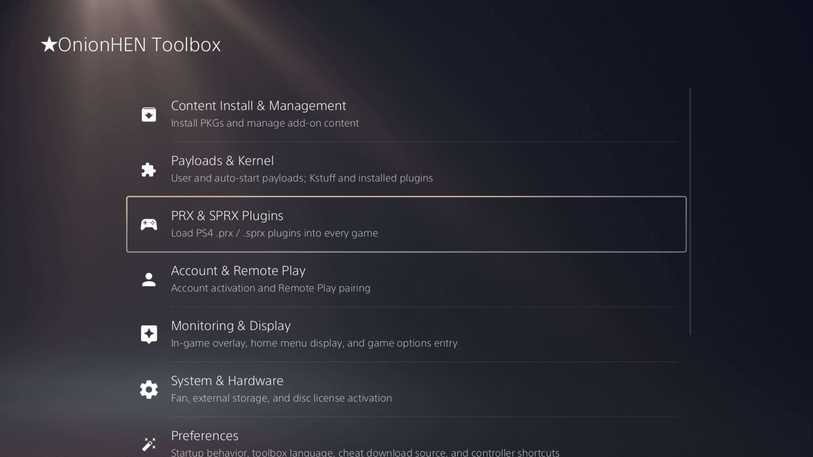
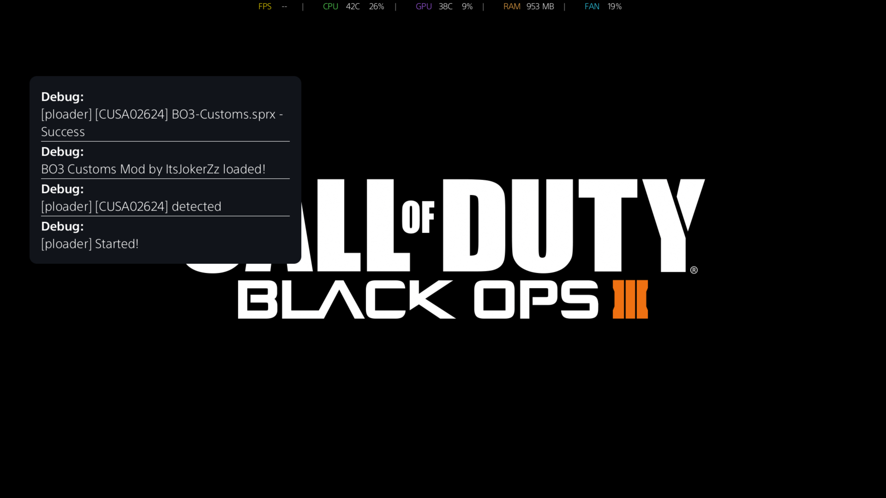

<p align="center">
  
</p>

<p align="center">
  <b>OnionHEN</b><br/>
  An all-in-one HEN and Toolbox for PlayStation 5
</p>

<p align="center">
This is not the original project. The original can be found <a href="https://github.com/aydencharles/onionHEN">here</a>
</p>

<p align="center">
  <b><a href="#features">Features</a></b>
  ·
  <b><a href="#run">Run</a></b>
  ·
  <b><a href="#build">Build</a></b>
  ·
  <b><a href="#configuration">Configuration</a></b>
  ·
  <b><a href="#support">Support</a></b>
  ·
  <b><a href="#credits">Credits</a></b>
</p>

---

<p align="center">
  <a href="LICENSE"></a>
  
  
  
  
</p>

<p align="center">
  OnionHEN is a PS5 HEN payload which gives support to load .prx, .sprx, and .elf payloads, install FPKG's, activate remote play, monitor temperatures, and give homebrew apps extra privileges.
</p>

<p align="center">
  This fork on OnionHEN has been customised to my liking. I have added a PS4 .prx and .sprx loader. I have removed features such as the cheat download functionality, official OnionHEN payloads.  
</p>

<p align="center">
  
</p>

<p align="center">
  
</p>

<br>

# Features

OnionHEN is a practical homebrew stack for jailbroken PS5 consoles.

- **Toolbox** — a settings page injected into the PS5 ShellUI 
- **System preparation** — raise privileges, remount filesystems, and block the update partition
- **.prx & .sprx loading (PS4) (experimental)** — load .prx & .sprx plugins for PS4 games (Cheats, patches, mods)
- **Remote Play pairing** — enable the native PS5 Remote Play service, generate a pairing PIN, and register a client from the Network section
- **User payload manager** — start and stop user-provided `.elf` payloads, with optional auto-start
- **Custom PKG Installer** — scan up to eight configured `/data` or `/mnt` folders for PS4 PKG files and submit them to the system installer
- **Game overlay** — an in-game bar for FPS, CPU, GPU, RAM, temperatures, and network info
- **Console tools** — account activation, external HDD, Title IDs, fan control, shortcuts, and game options
- **App jailbreak** — allowlisted homebrew can receive extra privileges through a sandbox FIFO

OnionHEN does not include a kernel exploit. The first hop still needs an
external `elfldr` on **9021**. After that, OnionHEN starts its own private
loader on **9020** for later ELF and user-payload launches.

<br>

# Run

### Requirements

1. A jailbroken PS5
2. An external [PS5 `elfldr`](https://github.com/ps5-payload-dev/elfldr) listening on port **9021** for the first hop

### Load OnionHEN

1. Run the kernel exploit and start the external `elfldr` service.
2. Send `OnionHEN.elf` through the loader your exploit host provides.

Startup is sequential. After the first hop, OnionHEN uses its own
`onion_elfldr.elf` on port **9020** and keeps **9021** only as a fallback.

```text
OnionHEN.elf → bootstrapper → onion_elfldr.elf (:9020) → util.elf → kstuff.elf → daemon.elf → Toolbox
```

### Remote Play

Remote Play pairing is available from **Toolbox → Network → Remote Play**.
The current account must already be activated. If it is not, OnionHEN blocks
the Remote Play page and directs you to **Toolbox → Account → Account
activation**. Once the account is activated, OnionHEN enables the Remote Play
registry setting and displays the pairing PIN. Enter that PIN in the official
Remote Play client while the page is open; OnionHEN uses the native PS5 Remote
Play service to confirm the registered device.

The feature provides pairing and registration only. Video streaming and client
transport remain handled by Sony's native Remote Play service.

### Payloads

Place standalone payloads in:

```text
/data/OnionHEN/payloads/
```

Only plain `.elf` files are supported. Auto-start can be turned on in the Toolbox;
OnionHEN remembers that choice with a matching `.auto_start` file next to the ELF.

# Build

### Dependencies

| Dependency | Purpose |
| --- | --- |
| [PS5 Payload SDK](https://github.com/ps5-payload-dev/sdk) | Prospero compiler, target headers, runtime, and CMake wrapper |
| CMake 3.20+ and Ninja | Configure and build the payload graph |
| Clang / LLVM | Compile the `x86_64-sie-ps5` targets |
| `lzma` or `xz` | Compress the bootstrapper |
| Git and `curl` or `wget` | Initialize submodules and fetch external payload inputs |

### Full build

```shell
git submodule update --init --recursive

export PS5_PAYLOAD_SDK=/path/to/ps5-payload-sdk
./scripts/build.sh --jobs 8
```

The script configures the project, fetches external dependencies, and builds
the embed chain in the required order.

For the reproducible Docker build:

```shell
docker compose build onionhen-build
docker compose run --rm onionhen-build
```

### Common options

| Option | Description |
| --- | --- |
| `--build-type Debug\|Release` | Select the CMake build type |
| `--build-dir <path>` | Override the default `build/` directory |
| `--cache-dir <path>` | Override `.cache/dependencies/` |
| `--stub-missing` | Use compile-only placeholder external ELFs; never use on hardware |
| `--skip-unpacker` | Stop after building the bootstrapper |
| `--init-submodules` | Initialize submodules before dependency sync |

Run `./scripts/build.sh --help` for the complete option list.

### Outputs

| Path | Description |
| --- | --- |
| `build/bin/OnionHEN.elf` | Final payload sent to the console |
| `build/bin/bootstrapper.elf` | Uncompressed bootstrapper |
| `build/bin/bootstrapper.elf.lzma` | Bootstrapper embedded by the final payload |
| `build/bin/daemon.elf` | Critical daemon |
| `build/bin/util.elf` | Utility daemon |
| `build/bin/shellui.elf` | Toolbox injection payload |
| `build/lib/*.a` | In-tree static libraries |

Build outputs stay in `build/`. Downloads are cached in `.cache/dependencies/`.
Nothing is written back into `source/`.

### Tests

Host tests cover settings, IPC, payload helpers, cheat parsers, relocation,
Toolbox routing, and shared platform code:

```shell
make -C source/util/tests clean
make -C source/util/tests test -j8
```

Linking the host tests needs Keystone on `KEYSTONE_PREFIX`
(default: `/opt/homebrew`).

<br>

# Configuration

OnionHEN reads and writes the same config in two places:

```text
/data/OnionHEN/config.ini
/user/data/OnionHEN/config.ini
```

Most options can be changed in the Toolbox. The format is
`schema_version=1`. If no file exists, OnionHEN writes a commented
default from [`config.ini.example`](config.ini.example).

The Custom PKG Installer stores folders as `pkg.search_path_0` through
`pkg.search_path_7`. Installation progress is shown by the PS5 system
installer. Firmware-specific package support still needs console validation.

| Key | Default | Values |
| --- | --- | --- |
| `meta.schema_version` | `1` | `1` |
| `toolbox.language` | `system` | `system`, `zh-Hans`, `zh-Hant`, `en`, `ja`, `ko`, `fr`, `de`, `it`, `es`, `pt-BR`, `pl`, `ru`, `ar`, `th` |
| `pkg.search_path_count` / `pkg.search_path_N` | `1` / `/data/OnionHEN/pkgs` | Up to 8 absolute `/data` or `/mnt` folder paths |
| `startup.open_after_load` | `none` | `none`, `home_menu` |
| `home_screen.show_title_ids` | `false` | `true`, `false` |
| `game_menu.show_onionhen_options` | `true` | `true`, `false` |
| `rest_mode.resume_reinject_delay_seconds` | `10` | `0` through `255` seconds |
| `cheats.mirror` | `auto` | `auto`, `github`, `cnb` |
| `app_jailbreak.debug_notifications` | `false` | `true`, `false` |
| `cooling.fan_control` | `automatic` | `automatic`, `temperature_threshold` |
| `cooling.temperature_threshold_celsius` | `77` | `0` through `100` |
| `overlay.enabled` | `true` | `true`, `false` |
| `overlay.background` | `true` | `true`, `false` |
| `overlay.edge` | `top` | `top`, `bottom` |
| `overlay.align` | `center` | `left`, `center`, `right` |
| `overlay.font_size` | `medium` | `small`, `medium`, `large` |
| `overlay.order` | `fps,cpu,gpu,memory,ip,fan` | comma-separated `fps`, `cpu`, `gpu`, `memory`, `ip`, `fan` |
| `overlay.show_cpu` / `overlay.show_gpu` / `overlay.show_memory` / `overlay.show_fps` | `true` | `true`, `false` |
| `overlay.cpu_usage_mode` | `average` | `average`, `per_core` |
| `overlay.show_ip_address` | `false` | `true`, `false` |
| `shortcuts.cheats_menu` | `off` | `off`, `r3_l3`, `l2_triangle`, `long_options`, `long_share`, `share` |
| `shortcuts.toolbox` | `off` | `off`, `l2_r3`, `long_share`, `share` |

### Runtime data

| Path | Purpose |
| --- | --- |
| `/data/OnionHEN/payloads/` | User payload ELFs |
| `/data/OnionHEN/plugins/` | Descriptor-bearing OnionHEN plugin ELFs |
| `/data/OnionHEN/cheats/` | Cheat files |
| `/data/OnionHEN/cheats_tmp/` | Temporary HTTPS ZIP and extraction files, cleaned after sync |
| `/data/OnionHEN/kstuff.elf` | Optional runtime override with priority over the embedded `kstuff` |
| `/data/OnionHEN/OnionHEN.log` | Main runtime log |
| `/data/OnionHEN/OnionHEN_crash.log` | Preserved daemon signal and backtrace log |
| `/data/OnionHEN/OnionHEN_util_daemon.log` | Utility daemon log |

<br>

# Host tools

| Tool | Purpose |
| --- | --- |
| [`scripts/daemon_log.py`](scripts/daemon_log.py) | Stream daemon logs; use [`scripts/capture_klog.py`](scripts/capture_klog.py) to capture kernel logs |
| [`scripts/shutdown_onion.py`](scripts/shutdown_onion.py) | Shut down the OnionHEN userland stack without killing `kstuff` |
| [`scripts/ps5_cmake.sh`](scripts/ps5_cmake.sh) | Run CMake through the PS5 payload SDK |
| [`scripts/sync_dependencies.sh`](scripts/sync_dependencies.sh) | Fetch or build external payload inputs |

<br>

# Repository layout

```text
.
├── assets/                    Project artwork
├── docs/                      Architecture and technical notes
├── scripts/                   Build, dependency, and host-side helpers
├── source/                    In-tree PS5 sources
│   ├── bootstrapper/          Startup and embedded payload chain
│   ├── daemon/                Critical daemon and Toolbox injection
│   ├── util/                  Utility daemon, IPC, and cheats
│   ├── shellui/               Toolbox and ShellUI hooks
│   ├── i18n/                  Shared Toolbox / notification locale catalogs
│   ├── unpacker/              Final OnionHEN payload wrapper
│   ├── libonion_*/            Shared in-tree libraries
│   ├── common/                Shared low-level implementations
│   └── platform/ps5/stubs/    PS5 system-library link stubs
├── third_party/               External source, archives, and submodules
├── tools/                     Repository-side generators
├── build/                     Generated build outputs (ignored)
└── .cache/dependencies/       Downloaded external inputs (ignored)
```

See [the architecture document](docs/arch.md) for the complete module and IPC map.


## Disclaimer

> OnionHEN is an unofficial homebrew project and is not affiliated with Sony Interactive Entertainment.
> Use it only on hardware you own and at your own risk. No warranty is provided.
